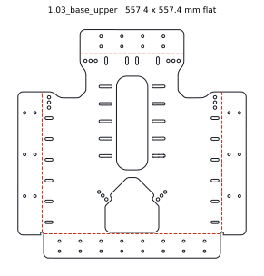
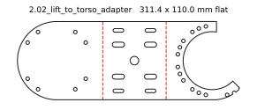
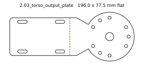
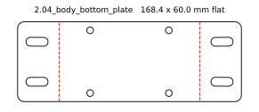
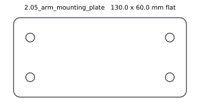
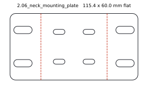

# sheet_metal — manufacturable flat patterns

The custom sheet-metal parts of MABEL's base and torso, as **DXF flat patterns ready to upload** to
an online laser-cut / bending service (SendCutSend, OSH Cut, Xometry, PCBWay sheet metal, …).
Operations, quantities and volume pricing are in
[`../README.md#sheet-metal-fabrication`](../README.md#sheet-metal-fabrication); the machine-readable
manifest is [`parts.csv`](parts.csv).

```text
dxf/        one flat pattern per part, millimetres, named <BOM ref>_<part>.dxf
previews/   SVG render of each flat pattern (solid = cut, red dashed = bend line)
parts.csv   ref, part, file, qty, flat size, bends, operations
```

## Parts

| Ref | Part | File | Qty | Flat size (mm) | Bends | Operations |
|---|---|---|---:|---|---:|---|
| 1.02 | Base sheet metal, lower | *not yet published — see below* | 1 | — | 0 | Laser cutting only |
| 1.03 | Base sheet metal, upper | [`dxf/1.03_base_upper.dxf`](dxf/1.03_base_upper.dxf) | 1 | 557.4 × 557.4 | 4 | Bends, dimple forming, hardware insertion, tapping |
| 2.02 | Lift-to-torso adapter | [`dxf/2.02_lift_to_torso_adapter.dxf`](dxf/2.02_lift_to_torso_adapter.dxf) | 1 | 311.4 × 110.0 | 2 | Bends, dimple forming, hardware insertion, tapping |
| 2.03 | Torso output plate | [`dxf/2.03_torso_output_plate.dxf`](dxf/2.03_torso_output_plate.dxf) | 1 | 196.0 × 77.5 | 1 | Bend, hardware insertion, tapping |
| 2.04 | Body bottom plate | [`dxf/2.04_body_bottom_plate.dxf`](dxf/2.04_body_bottom_plate.dxf) | 1 | 168.4 × 60.0 | 2 | Bends, hardware insertion, tapping |
| 2.05 | Arm mounting plate | [`dxf/2.05_arm_mounting_plate.dxf`](dxf/2.05_arm_mounting_plate.dxf) | **2** | 130.0 × 60.0 | 0 | Hardware insertion, tapping |
| 2.06 | Neck mounting plate | [`dxf/2.06_neck_mounting_plate.dxf`](dxf/2.06_neck_mounting_plate.dxf) | 1 | 115.4 × 60.0 | 2 | Bends only |

<p>


</p>
<p>




</p>

## Material

**5052-H32 aluminium, 0.080 in (2.0 mm)** — the material and gauge the reference quotes were made in.

> **Check 1.03 before ordering.** In the full assembly
> ([`../cad/`](../cad/)) the folded base upper (445 × 445 mm, ~62 mm flanges) has a volume that
> implies a sheet of ~3.2 mm (0.125 in) against this flat pattern, not 2.0 mm. Confirm the gauge
> against the STEP; it is the load-carrying tray, so if in doubt order it at 0.125 in.

## How to order

1. Upload the DXF. Every file is in **millimetres** (`$INSUNITS = 4`); confirm the part size the
   service reports matches the table above.
2. Pick the material and thickness above.
3. Each DXF uses Fusion 360's sheet-metal layer convention:

   | Layer | Meaning |
   |---|---|
   | `OUTER_PROFILES` | outside cut |
   | `INTERIOR_PROFILES` | holes and cutouts |
   | `BEND` | bend centre-line (angle and direction: see the folded part in the STEP) |
   | `BEND_EXTENT` | bend-zone boundary — reference only, not cut |

   Laser-only services cut `OUTER_PROFILES` + `INTERIOR_PROFILES`. Services that bend **from a 3-D
   model** (e.g. SendCutSend) need the folded part as STEP: fold the flat pattern in any CAD tool
   along the `BEND` lines, or take the body from the full assembly in [`../cad/`](../cad/).
4. Add the operations from the table: *hardware insertion* = PEM nuts / standoffs pressed in at the
   fabricator; *tapping* = threaded holes cut there; *dimple forming* = a shallow raised boss for
   fastener clearance.

## 1.02 — base sheet metal, lower (missing)

The flat, laser-cut-only lower base plate has not been published yet: no DXF of the quoted part
has been located, and it is not a separate body in the published assembly. Until it is added,
model it from the REV MAXSwerve module footprint and the base upper (1.03) bolt pattern.

## Provenance

Exported from the Fusion 360 sheet-metal design (flat pattern → DXF). Bend counts, part shapes
and quantities were checked against the fabrication quotes behind
[`../bom/data/machined.csv`](../bom/data/machined.csv). 1.03 was exported in inches and has been
scaled exactly ×25.4 to millimetres; all other files are unchanged exports.

Licensed under CERN-OHL-S-2.0 with the rest of the hardware ([`../../LICENSE-HARDWARE.txt`](../../LICENSE-HARDWARE.txt)).
